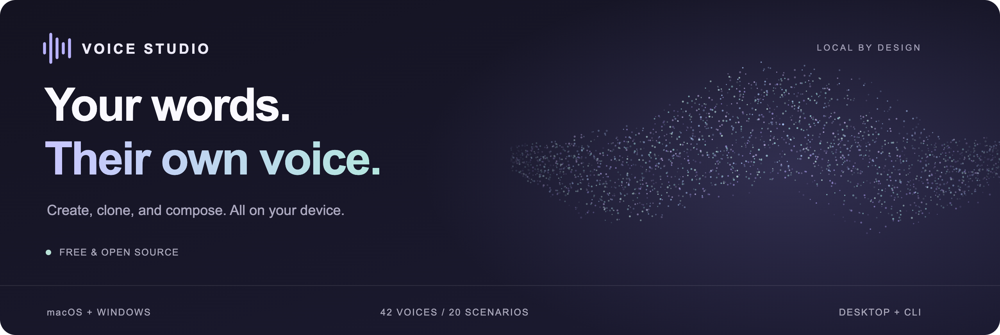
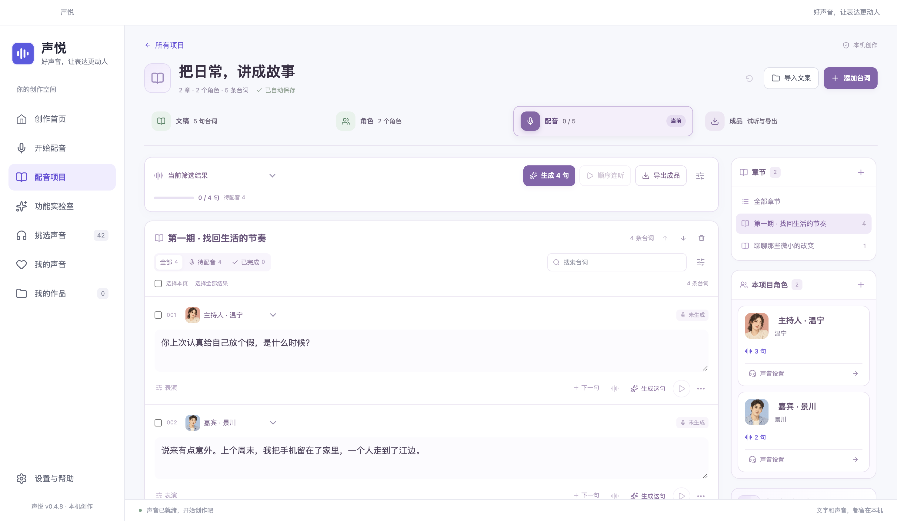
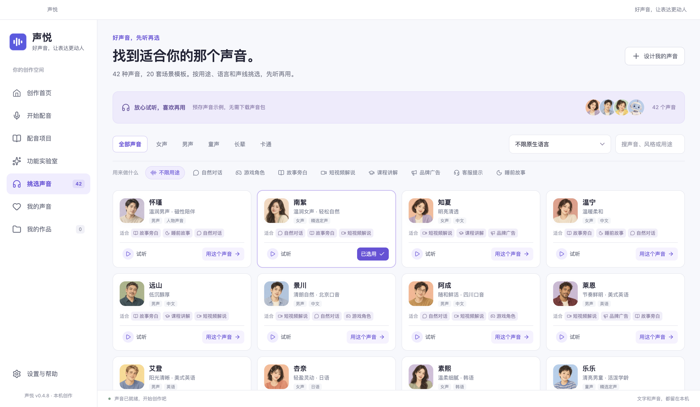
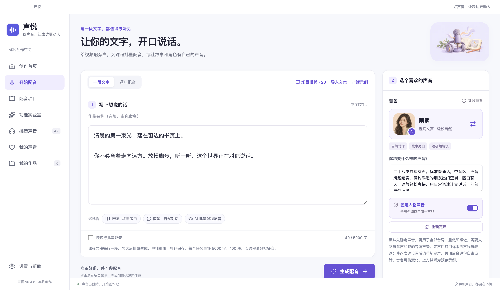

<div align="center">



<h1>Voice Studio · 声悦</h1>

<p><strong>Bring your words to life.</strong></p>
<p>A local workspace for narration, voice cloning, character dialogue, and finished audio.</p>

<p>
  <a href="https://voice.freeteam.top/en/download/"></a>
  <a href="LICENSE"></a>
  <a href="#download"></a>
  <a href="#local"></a>
</p>

<p>
  <a href="https://voice.freeteam.top/en/download/"><strong>Download</strong></a> ·
  <a href="https://voice.freeteam.top/en/#voices">Listen to voices</a> ·
  <a href="#quick-start">Get started</a> ·
  <a href="#cli">CLI & agents</a> ·
  <a href="README.md">简体中文</a>
</p>

</div>

<br>

<a href="docs/images/home.png"></a>

<p align="center"><sub>Current desktop interface with fictional demo content. The desktop UI is in Chinese; the website is available in Chinese and English.</sub></p>

## From a script to a finished piece

Narrate a lesson, build a two-person podcast, or give every character in a story a distinct voice. Voice Studio brings voice selection, writing, generation, review, and export into one local workspace.

<table>
<tr>
<td width="50%" valign="top">
<h3>01 &nbsp; Turn text into speech</h3>
<p>Choose a voice and delivery, then generate WAV and MP3. Start with 42 voice options, 20 scenario templates, and support for 10 languages.</p>
</td>
<td width="50%" valign="top">
<h3>02 &nbsp; Build a cast</h3>
<p>Organize characters, aliases, and chapters. Save a character's voice sample and reuse it across lines; adjust or regenerate individual lines.</p>
</td>
</tr>
<tr>
<td valign="top">
<h3>03 &nbsp; Reuse a familiar voice</h3>
<p>Import or record 3–30 seconds of authorized speech and confirm its transcript for voice cloning. An optional model adds expressive controls.</p>
</td>
<td valign="top">
<h3>04 &nbsp; Shape the final audio</h3>
<p>Compare takes, trim waveforms, adjust volume and fades, and add background music. Export merged audio, SRT subtitles, and individual segments.</p>
</td>
</tr>
<tr>
<td valign="top">
<h3>05 &nbsp; Keep long projects moving</h3>
<p>Manage chapters and queued work with pause, resume, retries, and local scheduling. Projects save automatically; completed clips remain available.</p>
</td>
<td valign="top">
<h3>06 &nbsp; Connect your workflow</h3>
<p>The desktop app and CLI share models, voices, and history. Structured JSON output works with scripts and agents that can execute local commands.</p>
</td>
</tr>
</table>

<p><sub>The 42 options include 9 fixed voices and 33 voice-design presets. Designed voices can vary; saved reference samples help preserve character identity. Review the generated audio before use.</sub></p>

## Inside the workspace

### One script. A whole cast.

Organize lines by character and chapter, adjust delivery, follow generation progress, and prepare exports. A project supports up to 100 characters, 200 chapters, 10,000 lines, and 500,000 text characters. Generation is split into sequential batches.

<a href="docs/images/project.png"></a>

<table>
<tr>
<td width="50%" valign="top">
<a href="docs/images/voices.png"></a>
<p><strong>Listen before you choose.</strong><br>Real bundled auditions, searchable by voice, language, and use case.</p>
</td>
<td width="50%" valign="top">
<a href="docs/images/workspace.png"></a>
<p><strong>Start with your words.</strong><br>A focused editor for voiceovers, lessons, and narrated stories.</p>
</td>
</tr>
</table>

**Voice samples:** [Nanxu · conversational](ui/assets/previews/warm-female.mp3) · [Jingchuan · podcast](ui/assets/previews/Dylan.mp3) · [Muyan · teaching](ui/assets/previews/clear-female.mp3) · [Xiaoyu · storytelling](ui/assets/previews/girl-clear.mp3) · [Explore all auditions →](https://voice.freeteam.top/en/#voices)

Samples retain their original spoken language.

<a id="local"></a>

## Made to run locally

- **Free and open source.** No purchase, activation, or cloud API key is required. The application source is MIT licensed.
- **Local inference.** Scripts, reference recordings, and generated audio stay on your device. After the initial component and model downloads, narration works offline.
- **Downloads you control.** Check your device first, choose resources and their storage location, then download. Pause, resume, and SHA-256 verification are built in.
- **Keep your work.** Drafts save automatically, original audio is retained, and selected takes carry through to exports.

<a id="download"></a>

## Download

The current release is **v0.4.8, free edition**. Desktop installers do not require a separate Node.js or Python installation.

| Platform | Requirements | Download |
| :--- | :--- | :--- |
| **Mac · Apple Silicon** | macOS 14+, M-series chip; MLX inference | [DMG](https://voice.freeteam.top/downloads/Shengyue-0.4.8-mac-arm64.dmg) · [ZIP](https://voice.freeteam.top/downloads/Shengyue-0.4.8-mac-arm64.zip) |
| **Mac · Intel** | macOS 14+, Intel x64; CPU inference | [DMG](https://voice.freeteam.top/downloads/Shengyue-0.4.8-mac-x64.dmg) · [ZIP](https://voice.freeteam.top/downloads/Shengyue-0.4.8-mac-x64.zip) |
| **Windows** | Windows 10 2004 / build 19041+ or Windows 11, x64; CPU inference | [Setup](https://voice.freeteam.top/downloads/Shengyue-0.4.8-windows-setup.exe) · [ZIP](https://voice.freeteam.top/downloads/Shengyue-0.4.8-win-x64.zip) |

Light mode requires at least **8 GB RAM**; other modes require at least **16 GB**. Leave additional disk space for models and runtime components; use the app's configuration check for the final estimate. Windows ARM is unsupported. Native Intel Mac and Windows acceptance coverage is documented in [VALIDATION.md](VALIDATION.md).

[Installation details and checksums →](https://voice.freeteam.top/en/download/)

<a id="quick-start"></a>

## Your first narration, in three steps

1. **Prepare.** Open the app, check your device, choose a storage location, and download the voice resources you need. Start with light mode on lower-memory devices.
2. **Write.** Choose a scenario or paste your text. Listen to voices and choose a delivery. Create a project for multi-character scripts.
3. **Review and export.** Generate, listen, regenerate or edit as needed, then save WAV or MP3. Projects can also export merged audio and SRT subtitles.

<details>
<summary><strong>First launch and common questions</strong></summary>

- **macOS blocks the app:** Move it to Applications, try opening it, then choose “Open Anyway” for this app in System Settings → Privacy & Security. Current Mac builds use ad hoc signing and are not Apple notarized.
- **Is internet access required?** Yes, for initial runtime and model downloads. Prepared models run locally afterward. Model weights are not included in this repository.
- **What about GPU acceleration?** Apple Silicon uses MLX. Current Windows and Intel Mac runtime packages use CPU inference; an accepted CUDA configuration is not provided.
- **Do all voices support emotion controls?** Light mode does not support performance instructions. Locked voices normally inherit their sample's expression; extra expression controls for reference voices require an optional resource download.
- **Can I process a book?** Use chapters and queued batches within project limits. Keep the computer and app running during processing; generation does not continue while the device is shut down.

</details>

<a id="cli"></a>

## A CLI for scripts and agents

Run these commands from a source checkout. Desktop installers also include a headless CLI; see the [full CLI reference](docs/Agent-CLI.md), currently in Chinese, for packaged app paths and the complete protocol.

```sh
# Discover the protocol and inspect local status
node cli/studio.cjs describe
node cli/studio.cjs status

# Explicit first-time download of light resources
node cli/studio.cjs setup --package light --timeout 3600

# Generate one clip, or process a JSON script
node cli/studio.cjs generate --text "Every story deserves a voice." \
  --speaker Ryan --engine light --output ./hello.wav

node cli/studio.cjs generate --input cli/example-script.json \
  --output-dir ./audio --timeout 1800
```

Ordinary commands return JSON on stdout and progress on stderr. Agents with local command execution can call the CLI directly. The desktop app's settings also provide commands and integration instructions for the current machine.

## Run from source

Requires **Node.js 22.12+**. The development version is recorded in `.nvmrc`. Initial resource preparation requires internet access.

```sh
git clone https://github.com/litefreeteam/voice-studio.git
cd voice-studio
npm ci
npm run resources
npm start
```

<details>
<summary><strong>Project layout, checks, and packaging</strong></summary>

```text
voice-studio/
├── ui/          Desktop interface, auditions, and artwork
├── desktop/     Electron, projects, jobs, and local storage
├── backend/     Python speech engines and audio processing
├── cli/         Command-line entry point and JSON Schema
├── shared/      Voice catalog, manifests, and model checksums
├── website/     Chinese and English product website
├── tests/       Node.js, Python, and UI regression checks
└── docs/        Development, integration, and historical notes
```

```sh
npm test                   # Python, CLI, projects, exports, and more
npm run test:security      # Security and resource integrity checks
npm run build:mac          # macOS arm64 / x64
npm run build:win          # Windows x64
```

Mac packaging requires macOS and Xcode Command Line Tools. See [validation notes](VALIDATION.md) for tested scope. Historical implementation notes are in [development and distribution](docs/开发与商业发行.md); the current free edition is controlled by `shared/edition.json`.

</details>

## Documentation and contributing

| I want to… | Start here |
| :--- | :--- |
| Install and check requirements | [Download guide](https://voice.freeteam.top/en/download/) |
| Automate narration | [CLI protocol and examples](docs/Agent-CLI.md) |
| Understand audio and subtitle exports | [Finished project export](docs/成品导出.md) |
| Check validation coverage | [Validation notes](VALIDATION.md) |
| Read historical release details | [Project history](docs/PROJECT_HISTORY.md) |
| Report a bug or suggest an improvement | [GitHub Issues](https://github.com/litefreeteam/voice-studio/issues) |
| Contribute code or documentation | [Contributing](CONTRIBUTING.md) |

Technical guides linked above are currently in Chinese.

## License and acknowledgments

Voice Studio source is released under the [MIT License](LICENSE). Built with [Qwen3-TTS](https://github.com/QwenLM/Qwen3-TTS), [MLX Audio](https://github.com/Blaizzy/mlx-audio), [VoxCPM](https://github.com/OpenBMB/VoxCPM), [Whisper](https://github.com/openai/whisper), and other open-source projects.

Third-party code, models, and runtimes retain their own licenses; see [THIRD_PARTY_NOTICES.md](THIRD_PARTY_NOTICES.md). Use voice recordings with permission and confirm the rights applicable to your content and intended use.

---

<p align="center">
  <strong>Let every story find its voice.</strong><br>
  <sub><a href="https://voice.freeteam.top/en/">Website</a> · <a href="https://voice.freeteam.top/en/#voices">Listen</a> · <a href="https://github.com/litefreeteam/voice-studio/issues">Feedback</a></sub>
</p>
