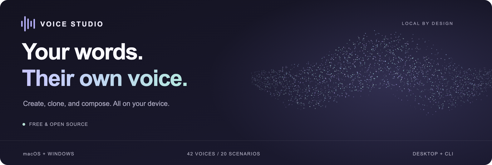
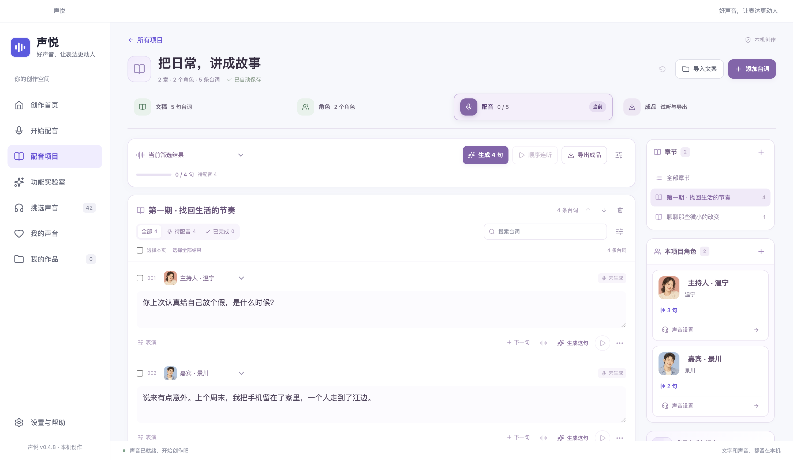

<div align="center">



<h1>声悦 · Voice Studio</h1>

<p><strong>好声音，让表达更动人。</strong></p>
<p>从一段文案到一部有声作品。配音、声音克隆、角色对白与音频编辑，都在你的电脑上完成。</p>

<p>
  <a href="https://voice.freeteam.top/download/"></a>
  <a href="LICENSE"></a>
  <a href="#download"></a>
  <a href="#local"></a>
</p>

<p>
  <a href="https://voice.freeteam.top/download/"><strong>下载桌面版</strong></a> ·
  <a href="https://voice.freeteam.top/#voices">在线试听</a> ·
  <a href="#quick-start">快速开始</a> ·
  <a href="#cli">CLI 与智能体</a> ·
  <a href="README.en.md">English</a>
</p>

</div>

<br>

<a href="docs/images/home.png"></a>

<p align="center"><sub>当前桌面端实拍 · 示例内容来自隔离的演示项目</sub></p>

## 把创作交给声音

为课程配上清晰的讲解，为播客安排自然的对谈，为故事里的每个角色找到自己的声线。声悦把选声、写稿、生成、试听和导出连在一起，让你专注于内容。

<table>
<tr>
<td width="50%" valign="top">
<h3>01 &nbsp; 让文字开口</h3>
<p>粘贴文案、选择声音与语气，生成 WAV 和 MP3。内置 42 个声音选项、20 套场景模板，支持 10 种语言。</p>
</td>
<td width="50%" valign="top">
<h3>02 &nbsp; 给角色自己的声音</h3>
<p>管理角色、别名与章节；人物声音可先定声，再复用于后续台词。课程、故事和双人播客都能逐句调整、逐句重做。</p>
</td>
</tr>
<tr>
<td valign="top">
<h3>03 &nbsp; 留住熟悉的声线</h3>
<p>导入或录制 3–30 秒参考人声，核对原话后用于声音克隆。可选的表达资源支持进一步调整语气与情绪。</p>
</td>
<td valign="top">
<h3>04 &nbsp; 从试听到成品</h3>
<p>比较生成版本，裁剪波形、调整音量与淡入淡出，添加背景音乐。按项目导出合并音频、SRT 字幕与分段备份。</p>
</td>
</tr>
<tr>
<td valign="top">
<h3>05 &nbsp; 让长篇持续向前</h3>
<p>按章节管理长文；后台队列支持暂停、续做、失败重试和本机预约。项目自动保存，已完成的片段可以继续使用。</p>
</td>
<td valign="top">
<h3>06 &nbsp; 接入你的工作流</h3>
<p>桌面端与 CLI 共用模型、声音和作品。命令输出结构化 JSON，可接入具有本地命令执行能力的智能体或自己的脚本。</p>
</td>
</tr>
</table>

<p><sub>42 个声音包含 9 款固定音色与 33 个人物设计预设。设计预设的生成效果可能变化；固定样本可用于保持角色身份，实际表现以试听为准。</sub></p>

## 看见你的工作台

### 多角色，一份完整的文稿

按角色和章节组织台词，在同一个项目中调整表达、管理生成进度和准备导出。单个项目支持最多 100 个角色、200 个章节、1 万条台词与 50 万字，生成时自动拆分为顺序处理的批次。

<a href="docs/images/project.png"></a>

<table>
<tr>
<td width="50%" valign="top">
<a href="docs/images/voices.png"></a>
<p><strong>先听，再选。</strong><br>真实的预存试听，按声线、语言和用途找到适合的声音。</p>
</td>
<td width="50%" valign="top">
<a href="docs/images/workspace.png"></a>
<p><strong>写下，就能开始。</strong><br>短视频旁白、课程讲解和故事朗读，共用清晰的创作入口。</p>
</td>
</tr>
</table>

**听听声线：** [南絮 · 日常聊天](ui/assets/previews/warm-female.mp3) · [景川 · 播客男声](ui/assets/previews/Dylan.mp3) · [沐言 · 课程讲解](ui/assets/previews/clear-female.mp3) · [小雨 · 故事童声](ui/assets/previews/girl-clear.mp3) · [浏览全部试听 →](https://voice.freeteam.top/#voices)

<a id="local"></a>

## 在本机，安心创作

- **免费开源。** 当前版本无需购买、激活或云端 API 密钥，源码采用 MIT 协议。
- **本地推理。** 文稿、参考录音和生成作品保存在本机；首次联网准备组件与模型后，可离线配音。
- **按需准备。** 首次启动检查设备配置，再由你选择资源和保存位置；下载支持暂停、续传与 SHA-256 校验。
- **保留创作过程。** 草稿自动保存，原始音频保留，生成版本可比较，选定的成品版本用于后续导出。

<a id="download"></a>

## 下载与安装

当前版本 **v0.4.8 免费版**。普通用户可直接安装桌面应用，无需配置 Node.js 或 Python。

| 平台 | 设备要求 | 安装包 |
| :--- | :--- | :--- |
| **Mac · Apple Silicon** | macOS 14+，M 系列芯片；MLX 推理 | [DMG](https://voice.freeteam.top/downloads/Shengyue-0.4.8-mac-arm64.dmg) · [ZIP](https://voice.freeteam.top/downloads/Shengyue-0.4.8-mac-arm64.zip) |
| **Mac · Intel** | macOS 14+，Intel x64；CPU 推理 | [DMG](https://voice.freeteam.top/downloads/Shengyue-0.4.8-mac-x64.dmg) · [ZIP](https://voice.freeteam.top/downloads/Shengyue-0.4.8-mac-x64.zip) |
| **Windows** | Windows 10 2004 / 19041+ 或 Windows 11，x64；CPU 推理 | [Setup](https://voice.freeteam.top/downloads/Shengyue-0.4.8-windows-setup.exe) · [ZIP](https://voice.freeteam.top/downloads/Shengyue-0.4.8-win-x64.zip) |

轻量模式至少需要 **8 GB 内存**，其他模式至少需要 **16 GB**。模型与运行组件需额外磁盘空间，最终以软件内的配置检查为准。Windows ARM 不在当前支持范围内；Intel Mac 与 Windows 的原生实机验收范围见 [验证记录](VALIDATION.md)。

[安装说明与校验值 →](https://voice.freeteam.top/download/)

<a id="quick-start"></a>

## 三步，开始第一段配音

1. **准备资源。** 启动应用，检查配置，选择模型保存位置并下载所需声音资源。内存较小的设备先选轻量配音。
2. **选声写稿。** 从创作首页选择场景，或直接粘贴文字。试听声音，设置语气；多角色内容可创建配音项目。
3. **试听导出。** 生成后逐句校对，需要时重做或编辑音频，再导出 WAV、MP3；项目还可导出合并成品与 SRT。

<details>
<summary><strong>macOS 首次打开与常见问题</strong></summary>

- **提示无法验证开发者：** 先将应用拖入“应用程序”，尝试打开后，在“系统设置 → 隐私与安全性”中为该应用选择“仍要打开”。当前 Mac 安装包使用 ad hoc 签名，尚未完成 Apple 公证。见 [首次打开说明](resources/macos/首次打开说明.template.html)。
- **首次使用需要联网吗？** 需要下载运行组件与所选模型。完成准备后，日常配音可离线运行；本仓库不包含模型权重。
- **有独立显卡会更快吗？** Apple Silicon 使用 MLX。当前 Windows 与 Intel Mac 安装组件采用 CPU 推理，不提供已验收的 CUDA 加速配置。
- **情绪控制适用于所有声音吗？** 轻量模式不支持表演指令；固定人物声音默认继承样本表达。参考声音的额外情绪控制需要主动下载可选资源。
- **可以处理整本书吗？** 项目支持长文、章节和队列拆批。大项目按顺序生成，处理期间需保持电脑与应用运行；关机后不会继续生成。

</details>

<a id="cli"></a>

## CLI，让声音接入工作流

在源码目录中运行下面的命令，即可读取协议、检查状态并调用本地模型。安装包也内置无窗口 CLI；路径与调用方式见 [完整 CLI 文档](docs/Agent-CLI.md)。

```sh
# 发现命令、输入结构与本机状态
node cli/studio.cjs describe
node cli/studio.cjs status

# 首次使用：主动下载轻量模型与运行组件
node cli/studio.cjs setup --package light --timeout 3600

# 生成一段声音，或用 JSON 文稿批量生成
node cli/studio.cjs generate --text "让每一句表达，都有自己的回响。" \
  --speaker Vivian --engine light --output ./hello.wav

node cli/studio.cjs generate --input cli/example-script.json \
  --output-dir ./audio --timeout 1800
```

常规命令以 JSON 返回结果，进度写入 stderr。具有本地命令执行能力的智能体可直接调用 CLI；桌面端的“设置与帮助 → 智能体与 CLI 接入”也可复制当前电脑的接入说明。

## 从源码运行

需要 **Node.js 22.12+**；仓库的 `.nvmrc` 提供开发使用的版本。首次构建资源与模型准备需要联网。

```sh
git clone https://github.com/litefreeteam/voice-studio.git
cd voice-studio
npm ci
npm run resources
npm start
```

<details>
<summary><strong>项目结构、测试与构建</strong></summary>

```text
voice-studio/
├── ui/          桌面界面、声音试听与创作素材
├── desktop/     Electron 主进程、项目、任务与本地存储
├── backend/     Python 语音引擎与音频处理
├── cli/         命令行入口与 JSON Schema
├── shared/      声音目录、资源清单与模型校验信息
├── website/     独立的中英文官网
├── tests/       Node.js、Python 与界面回归
└── docs/        开发、集成与版本记录
```

```sh
npm test                   # Python、CLI、项目与导出等回归
npm run test:security      # 安全边界与资源完整性
npm run build:mac          # macOS arm64 / x64
npm run build:win          # Windows x64
```

Mac 打包需 macOS 与 Xcode Command Line Tools。测试范围和目标平台限制见 [VALIDATION.md](VALIDATION.md)，更多构建细节见 [开发与发行记录](docs/开发与商业发行.md)。该文档保留历史授权实现，当前免费版以 `shared/edition.json` 为准。

</details>

## 文档与参与

| 你想做什么 | 从这里开始 |
| :--- | :--- |
| 安装、了解设备要求 | [下载与安装指南](https://voice.freeteam.top/download/) |
| 接入智能体、编写批处理脚本 | [CLI 协议与示例](docs/Agent-CLI.md) |
| 了解成品、字幕与混音导出 | [成品导出说明](docs/成品导出.md) |
| 查阅已验证范围与平台限制 | [验证记录](VALIDATION.md) |
| 查看历史版本与开发细节 | [历史记录](docs/PROJECT_HISTORY.md) |
| 报告问题或提出建议 | [GitHub Issues](https://github.com/litefreeteam/voice-studio/issues) |
| 改进代码或文档 | [贡献指南](CONTRIBUTING.md) |

## 开源许可与致谢

声悦源码采用 [MIT License](LICENSE)。感谢 [Qwen3-TTS](https://github.com/QwenLM/Qwen3-TTS)、[MLX Audio](https://github.com/Blaizzy/mlx-audio)、[VoxCPM](https://github.com/OpenBMB/VoxCPM)、[Whisper](https://github.com/openai/whisper) 及相关开源项目。

第三方代码、模型和运行库遵循各自许可，详见 [THIRD_PARTY_NOTICES.md](THIRD_PARTY_NOTICES.md)。声音克隆请使用已获授权的录音，并确认输入内容与输出用途的相应权利。

---

<p align="center">
  <strong>让每一句表达，都有自己的回响。</strong><br>
  <sub><a href="https://voice.freeteam.top/">声悦官网</a> · <a href="https://voice.freeteam.top/#voices">听听声音</a> · <a href="https://github.com/litefreeteam/voice-studio/issues">交流反馈</a></sub>
</p>
